# Torrent folder layout: review screenshots

Actual Windows dialog captures from the revised application, using a generated
local torrent. Each language is shown in light and dark mode with the folder
option enabled and disabled. The renderer is Direct3D 12. The WebP exports are
lossless and preserve the captured pixels exactly.

German and Arabic strings added for this option are marked as machine
translations in their catalogs and remain available for native-speaker review.

| Language and layout | Light | Dark |
| --- | --- | --- |
| English: Outer folder enabled | 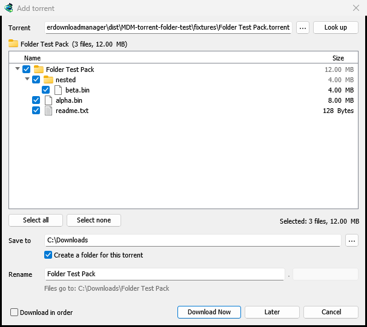 | 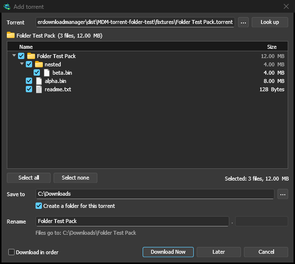 |
| English: Direct destination | 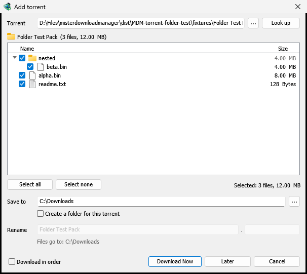 | 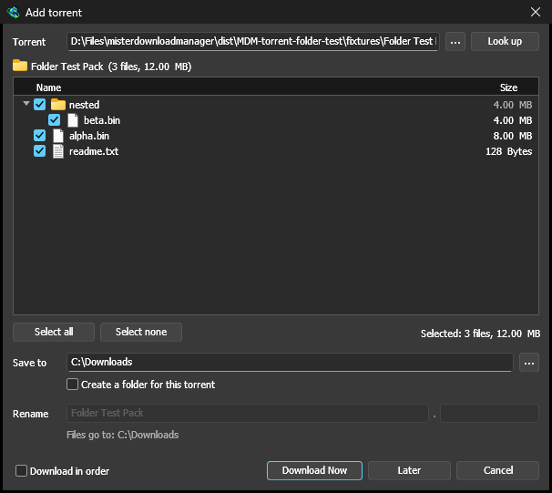 |
| German: Outer folder enabled | 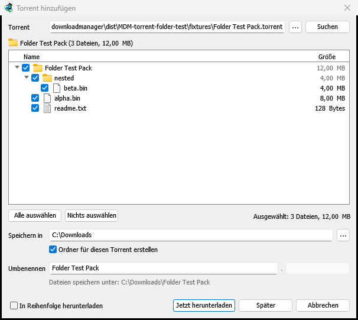 | 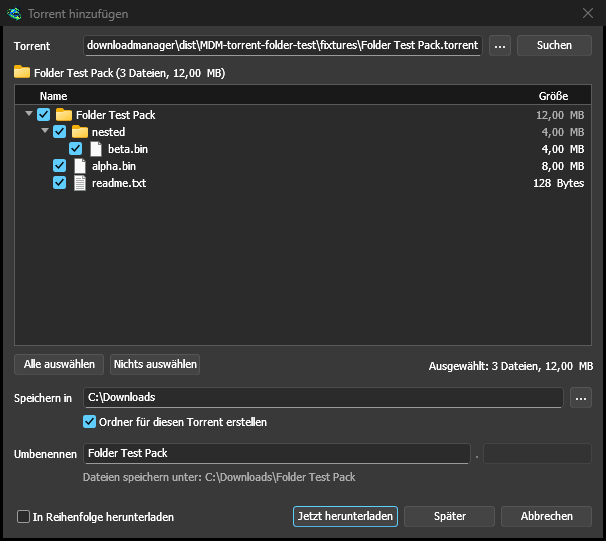 |
| German: Direct destination | 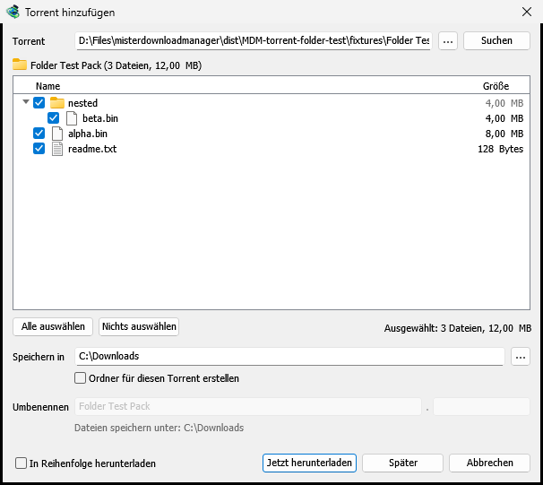 | 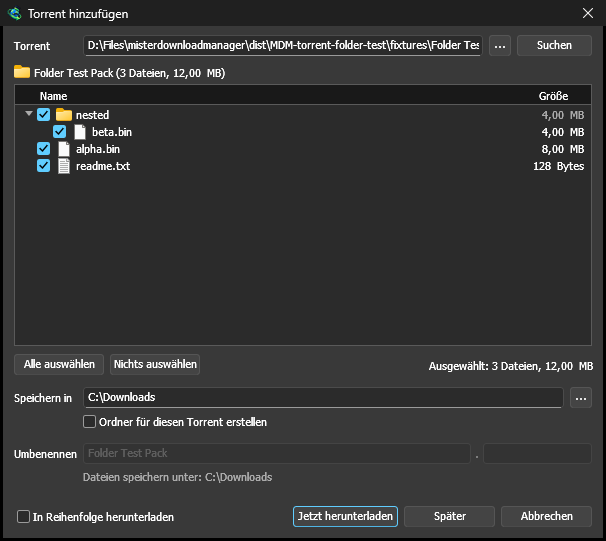 |
| Arabic: Outer folder enabled | 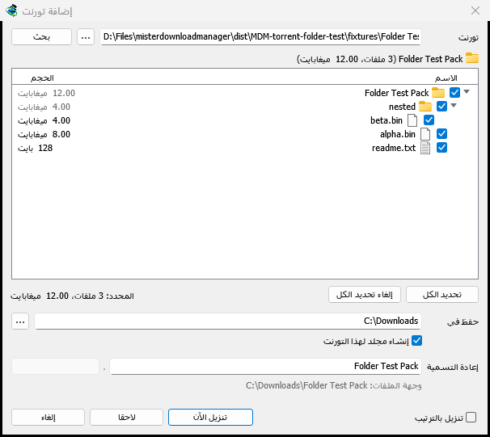 | 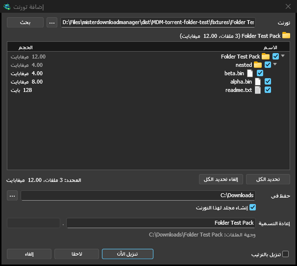 |
| Arabic: Direct destination | 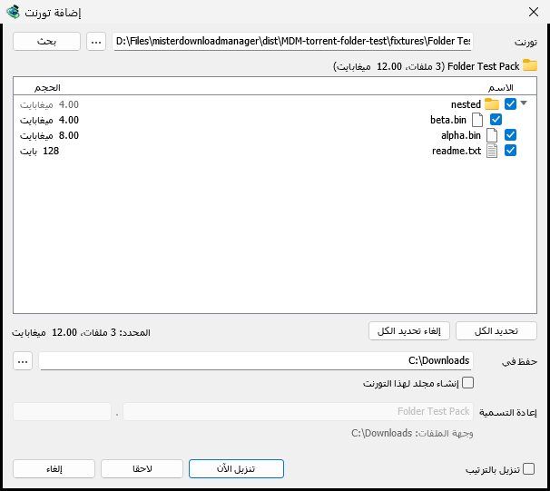 | 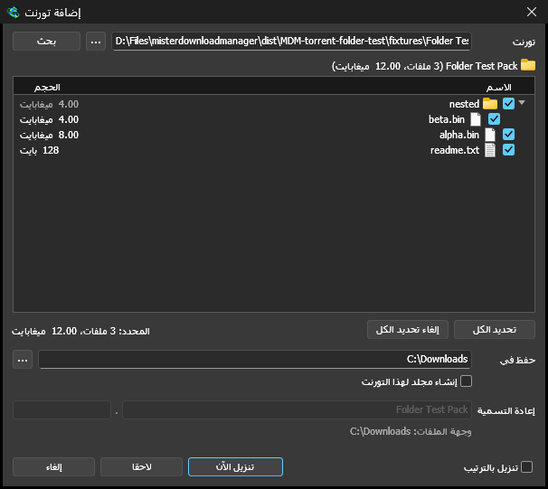 |
